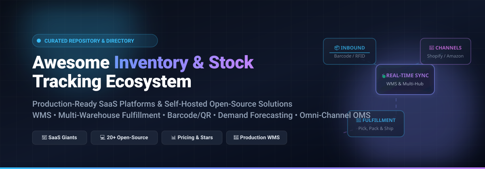

# 📦 Awesome Inventory &amp; Stock Level Tracking 🚀

**The definitive, production-ready directory of top SaaS platforms and self-hosted open-source software for real-time inventory control, warehouse management (WMS), multi-channel order fulfillment (OMS), barcode/RFID scanning, and supply chain logistics.**

---

## 📑 Table of Contents

- [📈 Sector Overview & Market Dynamics](#-sector-overview--market-dynamics)
- [🏢 SaaS/Hosted Platforms](#-saashosted-platforms)
- [💻 Open-Source GitHub Projects](#-open-source-github-projects)
- [🛠️ Developer Tools & Peripheral Libraries](#️-developer-tools--peripheral-libraries)
- [🤝 How to Contribute](#-how-to-contribute)
- [💖 Support & Sponsorship](#-support--sponsorship)
- [⭐ Star History](#-star-history)
- [⚠️ Disclaimer](#️-disclaimer)

---

## 📈 Sector Overview & Market Dynamics

The global inventory management software (IMS) and warehouse management system (WMS) market is currently valued at approximately **$2.7B to $3.7B** and is projected to reach **$5.5B–$7.1B** by 2030, registering a solid Compound Annual Growth Rate (CAGR) of **8.4%–9.5%**. 

Market concentration remains **moderately fragmented**: while massive enterprise ERP giants (such as SAP, Oracle, and Microsoft Dynamics) dominate multinational enterprise supply chains, the small-to-medium enterprise (SME), multi-channel direct-to-consumer (DTC), and mid-market warehousing segments remain highly competitive and fragmented across specialized cloud SaaS and open-source ecosystems rather than consolidating into a single winner-take-all winner.

---

## 🏢 SaaS/Hosted Platforms

A curated comparison of leading commercial and cloud-hosted inventory management, order routing, and 3PL platforms, sorted by **corporate scale / valuation (descending)**:

| 🏷️ Product | 📊 Scale (Revenue / Valuation) | 💵 Pricing | 🎁 Free Tier Limit |
|---|---|---|---|
| **[Stitch Labs (Square)](https://squareup.com)** | Parent Block: ~$25.6B Rev / Square: ~$10B+ Rev | Discontinued / Sunsetted after Square acquisition (historic pricing started at $799/month) | No free trial; standalone product retired |
| **[QuickBooks Commerce (formerly TradeGecko)](https://intuit.com)** | Parent Intuit: ~$21.5B Rev / ~$180B Market Cap | Discontinued / Sunsetted by Intuit (historic pricing started at $99/month) | No free trial; product discontinued (replaced by QuickBooks Online Plus/Advanced) |
| **[ShipBob](https://shipbob.com)** | ~$1.3B - $2.0B Valuation (~$500M ARR) | ~$275/month baseline platform/spend commitment (fulfillment charged per order + storage from $5/bin, $10/shelf, $40/pallet) | No free trial; interactive platform demo and custom shipping cost analysis available |
| **[Zoho Inventory](https://zoho.com)** | ~$1.45B Rev (Zoho Corporation) | $29/month billed annually ($39/mo billed monthly) for Standard plan | Free forever plan: 50 orders/month, 1 user, 1 warehouse location |
| **[Unleashed (The Access Group)](https://unleashedsoftware.com)** | ~$1.4B Rev (The Access Group) / ~$11B Valuation | $399/month billed annually for Starter/Core plan | 14-day free trial: Full access to core inventory modules, no credit card required |
| **[Katana Cloud Manufacturing](https://katanamrp.com)** | ~$150M - $250M Valuation (~$10M+ ARR) | Custom-scoped annual Advantage contract (legacy plans started at $179/month) | Free forever plan: 30 SKUs max, unlimited users, up to 3 locations (15-day initial grace period with unlimited SKUs) |
| **[Cin7 Core](https://cin7.com)** | ~$35M - $40M Rev | $349/month billed annually for Standard plan | 14-day free trial: Full feature access, no credit card required |
| **[Cin7 Orderhive](https://cin7.com/products/orderhive/)** | Cin7 Subsid.: ~$35M - $40M Rev | $44.99/month for Starter plan | 15-day free trial: Full automation and multi-channel order syncing, no credit card required |
| **[inFlow Inventory](https://inflowinventory.com)** | ~$12.2M Rev (Archon Systems) | $99/month billed annually ($129/mo billed monthly) for Entrepreneur plan | 14-day free trial: Full features enabled, 1,000 orders/yr cap, no credit card required |
| **[Fishbowl Inventory](https://fishbowlinventory.com)** | ~$10M - $15M Rev | $229/month billed annually for Fishbowl Essentials (includes 2 users) | No self-serve free trial; guided demo available via sales consultation |

---

## 💻 Open-Source GitHub Projects

Self-hosted, transparent, and extensible open-source projects for inventory control, warehouse management (WMS), ERP stock engines, and order management (OMS). **Sorted by GitHub_Stars (descending)**:

- **[Odoo Community Edition (Inventory & Sales)](https://github.com/odoo/odoo)**   
  Modular open-source ERP featuring double-entry inventory management, drop-shipping, cross-docking, barcode operations, and automated procurement rules.

- **[ERPNext (Stock & Buying/Selling Modules)](https://github.com/frappe/erpnext)**   
  Flagship open-source ERP suite offering full-featured warehouse management, serialized/batch inventory, automated reorder levels, and omnichannel order processing.

- **[Medusa](https://github.com/medusajs/medusa)**   
  Composable open-source commerce engine featuring multi-warehouse inventory allocation, automated order management (OMS), returns/exchanges, and fulfillment APIs.

- **[Bagisto](https://github.com/bagisto/bagisto)**   
  Open-source Laravel eCommerce platform featuring comprehensive multi-channel warehouse inventory tracking, order workflows, and catalog management.

- **[Saleor](https://github.com/saleor/saleor)**   
  GraphQL-first open-source e-commerce platform offering multi-warehouse stock management, click-and-collect routing, and split-order fulfillment.

- **[Spree Commerce](https://github.com/spree/spree)**   
  Mature open-source modular e-commerce and order management platform with multi-location inventory tracking, supplier dropshipping, and shipping integrations.

- **[Snipe-IT](https://github.com/snipe/snipe-it)**   
  Industry-standard open-source IT asset and equipment inventory management system supporting barcode/QR labels, check-in/check-out workflows, and audit logs.

- **[Invoice Ninja](https://github.com/invoiceninja/invoiceninja)**   
  Leading open-source billing and invoicing platform equipped with product inventory control, stock quantity warnings, and payment tracking.

- **[Grocy](https://github.com/grocy/grocy)**   
  Self-hosted open-source ERP-style household and small-scale stock management application featuring barcode lookup, expiration tracking, and chore/task automation.

- **[Homebox](https://github.com/sysadminsmedia/homebox)**   
  Fast, lightweight open-source inventory and organization system written in Go with QR code labeling, location hierarchies, and maintenance tracking.

- **[Dolibarr ERP & CRM (Products & Stock)](https://github.com/Dolibarr/dolibarr)**   
  All-in-one open-source business suite providing warehouse management, stock movements, purchase orders, shipments, and customer order workflows.

- **[InvenTree](https://github.com/inventree/InvenTree)**   
  Modern, open-source inventory management system built with Python/Django providing intuitive parts tracking, bill of materials (BOM), stock locations, and barcode generation.

- **[Solidus](https://github.com/solidusio/solidus)**   
  Flexible open-source Ruby on Rails commerce and order management system engineered for complex inventory allocation, returns, and custom fulfillment logic.

- **[Shelf.nu](https://github.com/Shelf-nu/shelf.nu)**   
  Modern open-source physical asset and inventory tracking platform featuring QR code scanning, custody logs, and location mapping.

- **[Metasfresh](https://github.com/metasfresh/metasfresh)**   
  Open-source ERP designed for SMEs with high-speed order entry, warehouse picking/packing, handling unit management, and EDI support.

- **[Part-DB](https://github.com/Part-DB/Part-DB-symfony)**   
  Open-source inventory management system built with Symfony and PHP, optimized for tracking electronic components, storage locations, suppliers, and datasheets.

- **[Apache OFBiz (Warehouse & Order Manager)](https://github.com/apache/ofbiz-framework)**   
  Enterprise open-source business automation framework delivering complete facility/warehouse management, picklists, shipping, and order orchestration.

- **[OpenBoxes](https://github.com/openboxes/openboxes)**   
  Open-source supply chain and warehouse management system (WMS) originally built for healthcare logistics, supporting lot/expiry tracking, requisitions, and shipments.

- **[Karrio](https://github.com/karrioapi/karrio)**   
  Open-source multi-carrier shipping API and fulfillment platform integrating directly with order management systems for label generation and tracking.

- **[iDempiere](https://github.com/idempiere/idempiere)**   
  Enterprise-grade open-source ERP/SCM platform supporting multi-warehouse logistics, material requirements planning (MRP), and order-to-cash cycles.

- **[Tryton](https://github.com/tryton/tryton)**   
  Modular open-source business management platform offering stock management, lot/serial tracking, dropshipping, and inventory valuation.

---

## 🛠️ Developer Tools & Peripheral Libraries

- 📱 **Barcode & QR Scanning**: [`ZXing`](https://github.com/zxing/zxing), [`bwip-js`](https://github.com/metafloor/bwip-js), and [`html5-qrcode`](https://github.com/mebjas/html5-qrcode) for integrating camera and industrial scanner inputs into custom warehouse apps.
- 📊 **Demand Forecasting & Optimization**: [`sktime`](https://github.com/sktime/sktime), [`Prophet`](https://github.com/facebook/prophet), and [`Stockpyl`](https://github.com/tbeasley/stockpyl) for calculating economic order quantity (EOQ), safety stock levels, and lead-time demand in Python.
- 📑 **EDI & Supply Chain Protocols**: [`Bots EDI`](https://github.com/e-b-s/bots) and [`pyx12`](https://github.com/azoner/pyx12) for parsing and generating ANSI X12 and EDIFACT purchase orders (850) and advance ship notices (ASN 856).
- 🏷️ **Thermal & Label Printing**: [`Labelary ZPL Engine`](https://github.com) and Zebra ZPL utilities for automated pallet and bin barcode printing.
- 🐳 **Infrastructure Deployment**: Production Docker Compose configurations and Helm charts for running InvenTree, ERPNext, and Medusa on Kubernetes with automated database volume snapshots.

---

## 🤝 How to Contribute

Contributions are warmly welcome to keep this directory updated and comprehensive! 🌟

1. 🍴 Fork the repository.
2. 🌿 Create a new branch: `git checkout -b feature/new-inventory-tool`.
3. 📝 Add or edit entries in `README.md` following the established format:
   - Must include name, direct link, Stars_Badge (if open-source), and an objective description.
   - For SaaS products, include pricing tier details and specific free tier/trial limits.
4. 🚀 Push your changes and open a Pull Request.

---

## 💖 Support & Sponsorship

If you find this curated directory helpful for your business, engineering projects, or warehouse operations, please consider showing your support:

- ⭐ **Star this repository** to help others discover it on GitHub.
- 🍴 **Fork and share** with colleagues, developers, and logistics teams.
- ☕ **Buy a coffee / Sponsor the author**: Support continuous open-source maintenance via the [GitHub Sponsor Dashboard](https://github.com/sponsors/ishandutta2007).

---

## 📊 Star History

---

## ⚠️ Disclaimer

- This repository is a **community-curated index** intended for informational and architectural research purposes. Inclusion does not imply official endorsement or sponsorship.
- Systems handling sensitive customer purchase orders, e-commerce transactions, and international shipping must comply with local tax, customs, and data privacy regulations (e.g., GDPR, CCPA, PCI-DSS).
- Self-hosted open-source warehouse systems require reliable offline-capable barcode scanning, transactional database isolation (to prevent inventory race conditions and overselling), and automated disaster recovery backups.
